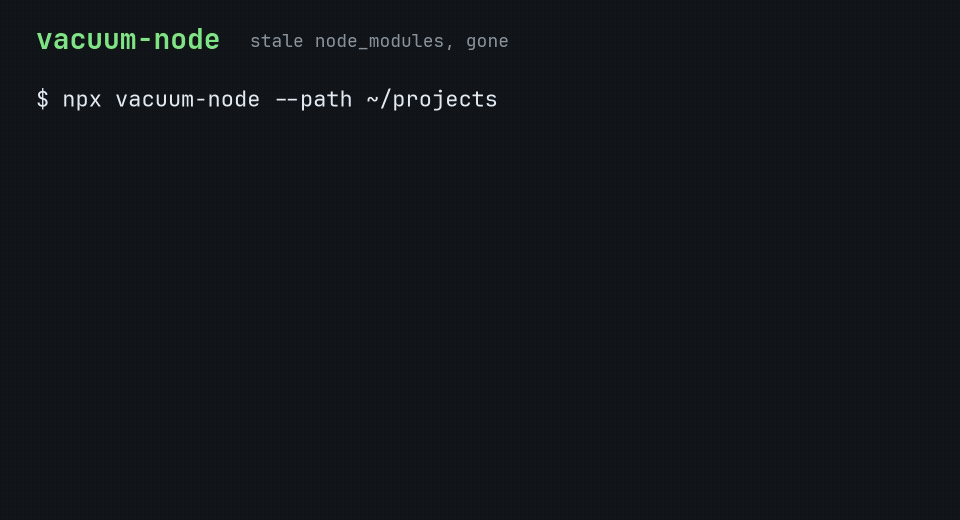

# vacuum-node

**One-command cleanup for stale node_modules and regenerable JS caches.**

Suggested GitHub description: **One-command cleanup for stale node_modules and regenerable JS caches.**

Suggested GitHub topics: `cli`, `nodejs`, `node-modules`, `disk-cleanup`, `developer-tools`, `typescript`.

`vacuum-node` walks a directory, shows how much space stale `node_modules` folders are using, and deletes them only after you say so. Pass `--caches` when you also want regenerable `.next`, `.turbo`, and `dist` directories included.



## Install

After the package is published:

```bash
npx vacuum-node
```

Or install it globally:

```bash
npm install -g vacuum-node
vacuum-node --help
```

From a clone of this repo:

```bash
npm install
node dist/cli.js --help
```

The scan root defaults to the **current directory**. It does not default to your home folder.

## Usage

Preview anything under the current directory that has not changed in 30 days:

```bash
npx vacuum-node
```

Preview a projects folder, using 14 days as the cutoff:

```bash
npx vacuum-node --path ~/projects --days 14
```

Delete those directories, and also delete regenerable caches, without a prompt:

```bash
npx vacuum-node --path ~/projects --caches --yes
```

On a terminal, the default is an interactive preview. Answering `y` or `yes` deletes the listed directories. Any other answer leaves them in place and exits 0.

Add `--json` for a machine-readable report. JSON output stays a dry run unless you also pass `--yes`. A non-interactive shell does the same: it prints the preview and deletes nothing unless `--yes` is set.

### Options

| Flag | Meaning |
| --- | --- |
| `-p, --path <dir>` | Directory to scan. Default: current directory. |
| `-d, --days <n>` | Minimum age in days. Default: `30`. |
| `-c, --caches` | Also include `.next`, `.turbo`, and `dist`. |
| `-y, --yes` | Delete without prompting. |
| `--json` | Print JSON. Dry run unless `--yes` is also set. |
| `-h, --help` | Show help. |
| `-v, --version` | Show the version. |

A directory is stale when its own mtime is **at least** `--days` old. The clock starts at the folder itself (the last time entries were added or removed), not at the newest file buried inside it.

Candidates are listed largest first, with a human-readable size and a total in GB.

### Exit codes

| Code | When |
| --- | --- |
| `0` | Success. This includes "nothing found" and a declined prompt. |
| `1` | Bad usage, or the scan root was refused as a system path. |
| `2` | At least one deletion failed. |
| `130` | Interrupted (Ctrl-C). |

## Safety

Deletion is the exception, not the default.

- The command previews first. It deletes only after `y` / `yes`, or when `--yes` is passed.
- Non-TTY sessions and `--json` never delete unless `--yes` is set.
- A path is removed only when its realpath is strictly inside the scan root. The check runs again immediately before each delete.
- The scan root itself is never a delete target.
- System locations are refused, including `/`, `/usr`, `/etc`, `/bin`, `/boot`, `/proc`, `/sys`, `/dev`, and Windows roots such as `C:\Windows`. A lookalike such as `/usr-local` is not treated as `/usr`.
- Directory symlinks are not followed. A `node_modules` (or cache) folder that is itself a symlink is skipped, so the link target is left untouched.
- Sizes do not follow symlinks, so a link to a large tree is not reported as reclaimable space.
- Only directories named `node_modules`, `.next`, `.turbo`, or `dist` can be deleted. `--caches` is what opts in to the last three. `dist` is a common build folder; do not point the tool at a source tree that stores real work in a directory with that name.
- The walker does not descend into `node_modules`. Nested copies are removed together with the outer folder.

## JSON

`--json` prints one object on stdout. `totalBytes` is exact. `totalGb` is the same total in gibibytes. `dryRun` is true when nothing was deleted. `removed` lists paths that were deleted. `errors` lists deletions that failed.

## Development

```bash
npm install
npm test
npm start -- --help
```

`npm test` compiles TypeScript and runs the Node.js test runner. `prepublishOnly` runs the tests, so a publish build has already passed them. The published bin is `dist/cli.js`.

See [CONTRIBUTING.md](CONTRIBUTING.md). MIT licensed.

## 中文简介

vacuum-node 用一条命令清理长期未改动的 `node_modules`，也可以一并清理可再生成的 `.next`、`.turbo` 和 `dist`。

默认只预览，列出体积和总 GB，不会删除。在交互终端里输入 `y` 或 `yes` 才会删除；也可以直接加 `--yes`。非交互环境和 `--json` 在没有 `--yes` 时始终只做预览。

```bash
npx vacuum-node
npx vacuum-node --path ~/projects --days 60
npx vacuum-node --caches --yes
```

扫描根目录默认是当前目录，不是用户主目录。它不会删除扫描根之外的路径，会拒绝系统目录，并且跳过符号链接，避免把链接目标清掉。
